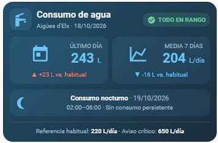

<p align="center">
  
</p>

# Aigües d'Elx para Home Assistant

Integración custom de Home Assistant para leer el consumo de agua del portal
[aigueselx.com](https://www.aigueselx.com/), que no dispone de API pública.

La integración hace scraping autenticado del portal (login con cookies +
token `p_auth`), descarga el consumo horario y lo importa como **estadísticas
externas** de Home Assistant, para que aparezcan en el panel de energía y en
las estadísticas de largo plazo.

## Características

- Login automático contra el portal de Aigües d'Elx.
- Refresco de sesión antes de cada consulta (el portal caduca la sesión por inactividad).
- Descarga del consumo horario de los últimos 3 días en cada ciclo (cada 6h).
- Importación como `external_statistics` de HA.
- Botón para cargar el histórico completo por intervalos de 90 días.
- Reintentos automáticos: 3 al arrancar (60s entre ellos) y hasta 4 reintentos cada 5 min si falla un ciclo.
- Sistema a prueba de datos a medias (sensores diarios y nocturnos solo muestran datos fiables).

## Instalación

### Vía HACS (recomendado)

1. En HACS, ve a **Integraciones** → menú de 3 puntos → **Repositorios personalizados**.
2. Añade `https://github.com/mizzard26/aigueselx` como tipo **Integration**.
3. Busca **Aigües d'Elx** en HACS e instálala.
4. Reinicia Home Assistant.

### Manual

1. Copia la carpeta `custom_components/aigueselx/` a tu carpeta `config/custom_components/`.
2. Reinicia Home Assistant.

## Configuración

1. Ve a **Ajustes → Dispositivos y servicios → Añadir integración**.
2. Busca **Aigües d'Elx**.
3. Introduce tu usuario y contraseña del portal.

## Entidades expuestas

- `sensor.consumo_agua_horario` — Último registro horario disponible.
- `button.cargar_historico_completo_agua` — Fuerza la carga del histórico completo.

---

## Sensores derivados (opcional)

Para que el consumo de agua se muestre en el **Panel de Energía** de HA y puedas usar la tarjeta de Lovelace que te propongo abajo, necesitas crear los sensores derivados. 

*Nota: estos sensores no los da la integración, se calculan a partir de las estadísticas de la misma.*

1. Copia el contenido de [`examples/recorder_statistics.yaml`](examples/recorder_statistics.yaml).
2. Pégalo en tu archivo `config/recorder_statistics.yaml` (o inclúyelo desde tu `configuration.yaml`).
3. Reinicia Home Assistant.

Este archivo crea los siguientes sensores:
- `sensor.consumo_agua_ultimo_dia_completo`: Consumo del último día cerrado (evita datos a medias).
- `sensor.consumo_agua_media_ultimos_7_dias`: Media de los últimos 7 días completos.
- `sensor.estado_consumo_agua_nocturno`: Analiza la madrugada (02:00–06:00) buscando la última noche completa disponible.

---

## Tarjeta de Lovelace (opcional)

<p align="center">
  
</p>

Puedes usar esta tarjeta (`custom:button-card`) para tener un resumen visual de tu consumo y detectar posibles fugas de forma rápida.

**Requisitos previos:**
- Tener instalada la integración y los sensores derivados.
- Tener instalada la tarjeta personalizada [Button Card](https://github.com/custom-cards/button-card) vía HACS.
- Crear 4 ayudantes (`input_number`) con estos nombres:
  - `input_number.consumo_agua_habitual` (ej. 220)
  - `input_number.consumo_agua_limite_diario` (ej. 600)
  - `input_number.consumo_agua_limite_diario_critico` (ej. 750)
  - `input_number.consumo_agua_limite_media_semanal` (ej. 325.5)

**Código de la tarjeta:**

```yaml
type: custom:button-card
name: Consumo de agua
icon: mdi:faucet
tap_action:
  action: navigate
  navigation_path: /energy/water
show_state: false
show_label: false
variables:
  habitual: |
    [[[
      return Number(states['input_number.consumo_agua_habitual']?.state ?? 220);
    ]]]
  limite_diario: |
    [[[
      return Number(states['input_number.consumo_agua_limite_diario']?.state ?? 600);
    ]]]
  limite_diario_critico: |
    [[[
      return Number(states['input_number.consumo_agua_limite_diario_critico']?.state ?? 750);
    ]]]
  limite_media_semanal: |
    [[[
      return Number(states['input_number.consumo_agua_limite_media_semanal']?.state ?? 325.5);
    ]]]
  ultimo_dia: |
    [[[
      const v = Number(states['sensor.consumo_agua_ultimo_dia_completo']?.state);
      return Number.isFinite(v) ? v : null;
    ]]]
  media_7_dias: |
    [[[
      const v = Number(states['sensor.consumo_agua_media_ultimos_7_dias']?.state);
      return Number.isFinite(v) ? v : null;
    ]]]
  fecha: |
    [[[
      return states['sensor.consumo_agua_ultimo_dia_completo']?.attributes?.fecha_dato ?? '--';
    ]]]
  supuesto: |
    [[[
      const dia = Number(states['sensor.consumo_agua_ultimo_dia_completo']?.state);
      const media = Number(states['sensor.consumo_agua_media_ultimos_7_dias']?.state);
      const limiteDia = Number(states['input_number.consumo_agua_limite_diario']?.state);
      const limiteSemana = Number(states['input_number.consumo_agua_limite_media_semanal']?.state);
      if (!Number.isFinite(dia) || !Number.isFinite(media) || !Number.isFinite(limiteDia) || !Number.isFinite(limiteSemana)) return 0;
      if (dia > limiteDia) return 3;
      if (media > limiteSemana) return 2;
      return 1;
    ]]]
styles:
  card:
    - background: linear-gradient(135deg, rgba(25,75,105,0.96), rgba(22,42,58,0.98))
    - border-radius: 16px
    - padding: 10px
    - color: white
    - box-shadow: none
    - max-width: 350px
    - margin: 0 auto
  grid:
    - grid-template-areas: >-
        "i n status" "i date status" "stats stats stats" "night night night"
        "footer footer footer"
    - grid-template-columns: 36px 1fr auto
    - grid-template-rows: min-content min-content min-content min-content min-content
    - column-gap: 8px
    - row-gap: 1px
  icon:
    - color: '#70CCFF'
    - width: 30px
  img_cell:
    - background: rgba(112,204,255,0.13)
    - border-radius: 10px
    - width: 36px
    - height: 36px
    - align-self: center
  name:
    - justify-self: start
    - font-size: 15px
    - font-weight: 600
    - color: white
  custom_fields:
    date:
      - justify-self: start
      - color: '#A9C4D5'
      - font-size: 10px
    status:
      - align-self: center
      - justify-self: end
    stats:
      - width: 100%
      - padding-top: 9px
    footer:
      - width: 100%
      - padding-top: 8px
    night:
      - width: 100%
      - padding-top: 8px
custom_fields:
  date: |
    [[[
      return `Aigües d'Elx · ${variables.fecha}`;
    ]]]
  status: |
    [[[
      const s = Number(variables.supuesto);
      const color = s === 1 ? '#72D6A0' : s === 2 ? '#FFC66D' : s === 3 ? '#FF806B' : '#A9C4D5';
      const fondo = s === 1 ? 'rgba(114,214,160,.14)' : s === 2 ? 'rgba(255,198,109,.14)' : s === 3 ? 'rgba(255,80,60,.17)' : 'rgba(169,196,213,.12)';
      const texto = s === 1 ? 'TODO EN RANGO' : s === 2 ? 'POSIBLE FUGA · 7 DÍAS' : s === 3 ? 'POSIBLE FUGA ACTIVA' : 'SIN DATOS';
      const icono = s === 1 ? 'mdi:check-circle' : s === 0 ? 'mdi:help-circle-outline' : 'mdi:alert';
      return `<span style="display:inline-flex;align-items:center;gap:4px;background:${fondo};color:${color};border-radius:10px;padding:4px 7px;font-size:10px;font-weight:600;white-space:nowrap"><ha-icon icon="${icono}" style="--mdc-icon-size:14px"></ha-icon>${texto}</span>`;
    ]]]
  stats: |
    [[[
      const s = Number(variables.supuesto);
      const habitual = Number(variables.habitual);
      const ultimo = variables.ultimo_dia;
      const media = variables.media_7_dias;
      const azul = '#70CCFF';
      const rojo = '#FF806B';
      const colorDia = s === 3 ? rojo : azul;
      const colorSemana = s === 1 ? azul : rojo;
      const fondoDia = s === 3 ? 'rgba(255,80,60,.12)' : 'rgba(112,204,255,.09)';
      const fondoSemana = s === 1 ? 'rgba(112,204,255,.09)' : 'rgba(255,80,60,.12)';
      const desviacion = valor => {
        if (valor === null) return '<div style="font-size:10px;color:#A9C4D5;margin-top:6px">Sin datos disponibles</div>';
        const delta = Math.round(valor - habitual);
        const flecha = delta > 0 ? '▲' : delta < 0 ? '▼' : '—';
        const signo = delta > 0 ? '+' : '';
        return `<div style="font-size:10px;color:${valor > habitual ? rojo : azul};margin-top:6px">${flecha} ${signo}${delta} L vs. habitual</div>`;
      };
      const bloque = (titulo, valor, color, fondo) => `
        <div style="background:${fondo};border-radius:11px;padding:9px">
          <div style="display:flex;align-items:center;gap:7px">
            <ha-icon icon="${titulo === 'ÚLTIMO DÍA' ? 'mdi:calendar-today' : 'mdi:chart-line'}" style="color:${color};--mdc-icon-size:32px;flex-shrink:0"></ha-icon>
            <div style="min-width:0">
              <div style="font-size:10px;color:#A9C4D5">${titulo}</div>
              <div style="font-size:22px;line-height:1.3;font-weight:600;color:${color}">${valor === null ? '—' : Math.round(valor).toLocaleString('es-ES')} <span style="font-size:11px;font-weight:400">${titulo === 'MEDIA 7 DÍAS' ? 'L/día' : 'L'}</span></div>
            </div>
          </div>
          ${desviacion(valor)}
        </div>`;
      return `<div style="display:grid;grid-template-columns:1fr 1fr;gap:7px">
        ${bloque('ÚLTIMO DÍA', ultimo, colorDia, fondoDia)}
        ${bloque('MEDIA 7 DÍAS', media, colorSemana, fondoSemana)}
      </div>`;
    ]]]
  footer: |
    [[[
      return `<div style="border-top:1px solid rgba(255,255,255,.13);padding-top:8px;font-size:10px;color:#A9C4D5">Referencia habitual: <b style="color:white">${variables.habitual} L/día</b> · Aviso crítico: <b style="color:white">${variables.limite_diario_critico} L/día</b></div>`;
    ]]]
  night: |
    [[[
      const entidad = states['sensor.estado_consumo_agua_nocturno'];
      const estado = entidad?.state;
      const error = !entidad || ['unknown', 'unavailable'].includes(estado);
      const continuado = estado === 'Consumo continuado';
      const falta = estado === 'Falta información';

      const fechaNoche = states['sensor.estado_consumo_agua_nocturno']?.attributes?.fecha_dato ?? '--';
      const color = error || falta ? '#FFC66D' : continuado ? '#FF806B' : '#70CCFF';
      const fondo = error || falta ? 'rgba(255,198,109,.14)' : continuado ? 'rgba(255,80,60,.17)' : 'rgba(112,204,255,.09)';
      const icono = error ? 'mdi:alert-circle-outline' : falta ? 'mdi:database-alert-outline' : continuado ? 'mdi:water-alert' : 'mdi:moon-waning-crescent';
      const texto = error ? 'Sin datos disponibles' : estado === 'Consumo interrumpido' ? 'Sin consumo persistente' : estado;

      return `
        <div style="display:flex;align-items:center;gap:9px;background:${fondo};border-radius:11px;padding:8px 10px">
          <ha-icon icon="${icono}" style="color:${color};--mdc-icon-size:23px;flex-shrink:0"></ha-icon>
          <div style="flex:1;min-width:0">
            <div style="font-size:11px;font-weight:600;color:white">Consumo nocturno <span style="color:#A9C4D5;font-weight:400">· ${fechaNoche}</span></div>
            <div style="font-size:10px;color:#A9C4D5;margin-top:2px">02:00–06:00 · ${texto}</div>
          </div>
        </div>`;
    ]]]